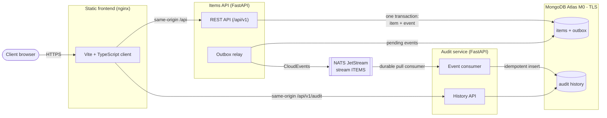
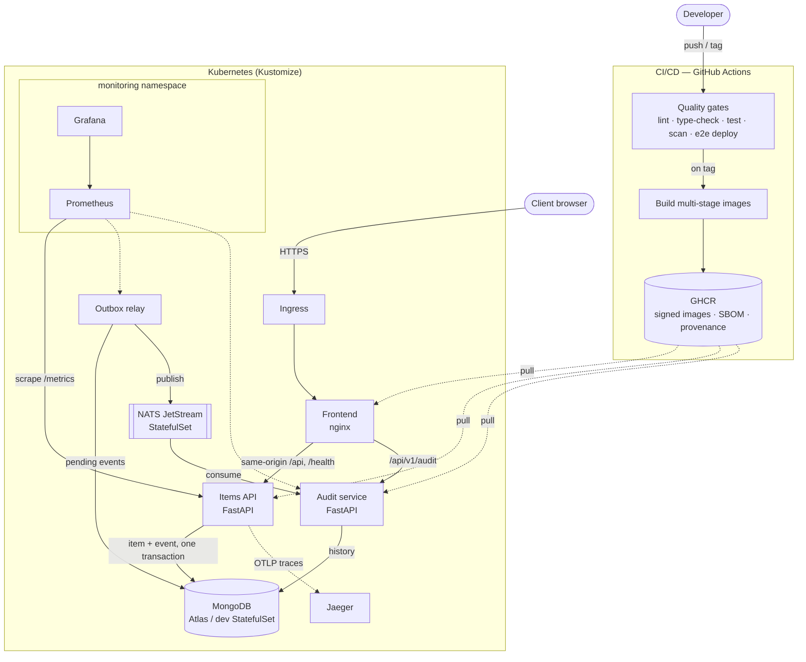

# Automated Cloud Architecture for MongoDB-Backed Microservices

Production-grade reference architecture for asynchronous, MongoDB-backed
microservices that integrate through events. It is engineered for automation,
resilience, security, and observability, and delivered strictly within provider
free tiers.

[](https://github.com/Carlosmarroquin20/Automated-Cloud-Architecture-for-MongoDB-Backed-Microservices/actions/workflows/ci.yml)
[](https://github.com/Carlosmarroquin20/Automated-Cloud-Architecture-for-MongoDB-Backed-Microservices/actions/workflows/codeql.yml)
[](https://securityscorecards.dev/viewer/?uri=github.com/Carlosmarroquin20/Automated-Cloud-Architecture-for-MongoDB-Backed-Microservices)


## Overview

This repository demonstrates the design and delivery of a cloud-native
microservice from first commit to production topology. It targets SOC 2 and
ISO 27001 operational hygiene and aligns with the AWS Well-Architected Framework
pillars of Operational Excellence, Security, Reliability, Performance Efficiency,
and Cost Optimization.

Delivery is modular: each layer is implemented, verified, and reviewed
independently. All layers are complete: application, containerization,
infrastructure as code, orchestration, CI/CD, and observability. On top of them,
the items API publishes its changes as events through a transactional outbox
and NATS JetStream to a second service, which keeps an audit history. Every
push deploys the whole system to an ephemeral cluster and proves that an
event crosses it, including a single trace that spans the request, the publish,
and the consumption.

## Architecture



The frontend is served as optimized static assets behind a reverse proxy that
forwards `/api` and `/health` to the services, so the browser issues only
same-origin requests and no backend host is embedded in the shipped assets.

The items API writes every change and a CloudEvents event in the same MongoDB
transaction (a transactional outbox), so a change is never stored without its
event. A relay publishes committed events to NATS JetStream, which deduplicates
republished messages. The audit service consumes them through a durable
consumer, records each one idempotently in its own database, and serves an
item's history even after the item is deleted. Both services connect to MongoDB
with pooled connections, explicit timeouts, and jittered retries.

The reasoning behind these choices is recorded as
[Architecture Decision Records](docs/adr/README.md). The system is also described
at the context, container, and component levels of the C4 model in
[docs/architecture.md](docs/architecture.md). The interfaces are versioned
contracts checked in CI: [docs/api/openapi.json](docs/api/openapi.json) for the
REST API and [docs/api/asyncapi.yaml](docs/api/asyncapi.yaml) for the events.

### Delivery and runtime topology

End to end, from a commit to an observed running system:



The application request path is the solid line client → ingress → frontend →
API → database; events flow from the outbox through the relay and JetStream to
the audit service. Prometheus scrapes all three services, Grafana visualizes
them, and every service emits OTLP traces to Jaeger (dashed, opt-in). Images are
built, signed, and pulled from GHCR.

## Technology

| Concern | Technology |
|---------|------------|
| API | Python 3.10+, FastAPI, Pydantic v2, PyMongo (async client) |
| Frontend | TypeScript, Vite — framework-free, zero runtime dependencies |
| Database | MongoDB Atlas (M0 free tier, TLS-only), database per service |
| Messaging | NATS JetStream, transactional outbox, CloudEvents 1.0, AsyncAPI 3.0 |
| Backend quality | ruff, mypy (`--strict`), pytest |
| Frontend quality | ESLint, tsc (strict), Vitest |
| Containers | Multi-stage Docker (distroless backend, nginx frontend), Compose |
| Infrastructure | Terraform (modular AWS, free-tier), SSM Session Manager |
| Orchestration | Kubernetes, Kustomize, HPA, NetworkPolicies |
| CI/CD | GitHub Actions (lint, test, scan, build, ephemeral deploy + smoke test) |
| Observability | Prometheus (scrape + alerts), Grafana (provisioned dashboards), OpenTelemetry + Jaeger |

## Repository Structure

```
.
├── src/
│   ├── backend/          # Items API and outbox relay (FastAPI)
│   ├── audit/            # Audit service: event consumer and history API
│   └── frontend/         # Vite + TypeScript static client
├── .github/              # CI/CD pipelines and dependency automation
├── terraform/            # Infrastructure as Code (modular AWS)
├── k8s/                  # Kubernetes manifests (Kustomize base + overlay)
├── observability/        # Prometheus config + Grafana dashboards
├── docs/                 # ADRs, C4 architecture, OpenAPI and AsyncAPI contracts
├── scripts/              # End-to-end smoke test
├── docker-compose.yml    # Local multi-service orchestration
├── .gitattributes        # LF normalization for portable builds
└── .gitignore            # Zero-trust exclusion policy
```

## Delivery Roadmap

| Layer | Scope | Status |
|-------|-------|--------|
| 0 | Repository baseline · zero-trust ignore policy | ✅ Complete |
| 1 | Application — async FastAPI API + MongoDB persistence | ✅ Complete |
| 1 | Application — static Vite + TypeScript client | ✅ Complete |
| 2 | Containerization — multi-stage Docker, Compose | ✅ Complete |
| 3 | Infrastructure as Code — Terraform modules | ✅ Complete |
| 4 | Orchestration — Kubernetes probes, limits, policies | ✅ Complete |
| 5 | CI/CD — GitHub Actions (lint, test, scan, deploy) | ✅ Complete |
| 6 | Observability — Prometheus metrics, Grafana dashboards | ✅ Complete |
| + | Event-driven integration — outbox, NATS JetStream, audit service, cross-service tracing | ✅ Complete |

## Getting Started

### Full stack

```bash
docker compose up --build        # UI at http://localhost:8080
```

Compose runs MongoDB as a single-member replica set (the outbox needs
transactions), NATS with JetStream, the items API, the outbox relay, the audit
service, and the frontend. Add `--profile observability` for Prometheus, Grafana,
and Jaeger.

### Backend

```bash
cd src/backend
python -m venv .venv
. .venv/Scripts/activate         # Git Bash on Windows; use bin/activate on Unix
pip install -r requirements-dev.txt
cp .env.example .env             # set MONGODB_URI and MONGODB_DB_NAME
uvicorn app.main:app --reload
```

Interactive API documentation is served at `/docs` in non-production
environments. See [`src/backend/README.md`](src/backend/README.md) for details.

### Frontend

```bash
cd src/frontend
npm install
npm run dev                      # proxies /api and /health to localhost:8000
```

See [`src/frontend/README.md`](src/frontend/README.md) for details.

## Quality Gates

Every layer ships with automated verification.

| Component | Gates |
|-----------|-------|
| Backend | `ruff check` · `mypy --strict` (50 files) · `pytest` (62 tests) · OpenAPI drift check · AsyncAPI contract tests |
| Audit service | `ruff check` · `mypy --strict` (15 files) · `pytest` (20 tests) |
| Frontend | `eslint` · `tsc --noEmit` (strict) · `vitest` (18 tests) · `vite build` |
| Monitoring | `promtool check config` for both Prometheus configurations · `promtool test rules` unit tests for the alerts · dashboard and rule copies kept identical |

The frontend production bundle is approximately 6.6 kB gzipped (JavaScript and
CSS combined). All test suites are hermetic and require no database or broker.

## Continuous Integration and Delivery

Every push and pull request runs a parallel quality-gate graph in GitHub Actions,
followed by container build, vulnerability scanning, and a real deployment to an
ephemeral cluster.

| Stage | Tooling |
|-------|---------|
| Lint · type-check · test | ruff, mypy `--strict`, pytest for both services (Python 3.10–3.12 matrix); ESLint, tsc, Vitest |
| IaC validation | `terraform fmt`/`validate`; Kustomize render validated with kubeconform; promtool |
| Static analysis | CodeQL (Python, TypeScript); Hadolint (Dockerfiles) |
| Supply chain | gitleaks secret scan, dependency review, Dependabot |
| Image security | Trivy configuration and image scans (results as SARIF) |
| Deploy verification | Dev overlay applied to an ephemeral kind cluster; rollouts awaited; smoke test through the frontend (CRUD, audit history, rate limit); outbox, stream, and consumer state asserted; one trace verified across API, relay, and consumer |

Tagged releases (`vX.Y.Z`) build and publish semantically versioned images to the
GitHub Container Registry with build provenance and an SBOM. All scanners surface
findings in the repository Security tab. The pipeline runs entirely on
GitHub-hosted runners within the free tier and requires no external secrets — the
registry credential is the ephemeral `GITHUB_TOKEN`.

## Observability

Every service exports Prometheus metrics: the items API on `/metrics` using
route templates as labels to bound cardinality, the outbox relay on a dedicated
port, and the audit service on its API port. A local monitoring plane —
Prometheus for collection and alerting, Grafana for visualization — is
provisioned as code and started on demand behind a Compose profile; the same
configuration deploys to Kubernetes as the `k8s/monitoring` overlay.

```bash
docker compose --profile observability up --build
```

Grafana (http://localhost:3000) provisions two dashboards. **Microservice
Overview** covers request throughput, error ratio, latency percentiles
(p50/p95/p99), in-flight saturation, and process resource usage. **Event
Pipeline** covers publication and consumption rates, consumption outcomes,
outbox backlog age, broker duplicates, and the consumer's binding to the stream.
Prometheus (http://localhost:9090) evaluates availability and SLO rules for the
API and progress rules for the event pipeline, which fails silently from a
client's point of view. All tools are open-source and run at no cost. See
[`observability/`](observability/) for configuration and dashboards.

The three observability signals are complete: alongside metrics and structured
logs, every service is instrumented with OpenTelemetry for distributed traces.
The trace context is stored with each outbox event and carried in the message
headers, so a single trace follows a change from the request through the relay
to the audit service. Tracing is opt-in (`OTEL_ENABLED`, off by default); when
enabled with the observability profile, spans are exported to a bundled Jaeger
instance (http://localhost:16686):

```bash
OTEL_ENABLED=true docker compose --profile observability up --build
```

## Engineering Principles

- **Zero-trust secrets** — no credentials, keys, or hosts in the repository;
  configuration is injected at runtime through environment variables.
- **Minimal attack surface** — a framework-free frontend and a distroless image
  target keep dependencies and exposure low.
- **Resilience** — bounded, jittered retries, explicit timeouts, and readiness
  gating so a transient database outage degrades gracefully instead of crashing.
- **Reliable messaging** — events commit atomically with their state change and
  are delivered at least once; deduplication at the broker and idempotent
  consumers make processing effectively once.
- **Observability** — structured JSON logs with per-request correlation
  identifiers, ready for aggregation.
- **12-factor configuration** — strictly separated config, validated at startup.
- **Zero cost** — every component fits provider free tiers and open-source tools.

## Contributing and security

Contribution setup, quality gates, and conventions are documented in
[CONTRIBUTING.md](CONTRIBUTING.md). Security vulnerabilities should be reported
privately as described in [SECURITY.md](SECURITY.md).

## License

Released under the [MIT License](LICENSE).
