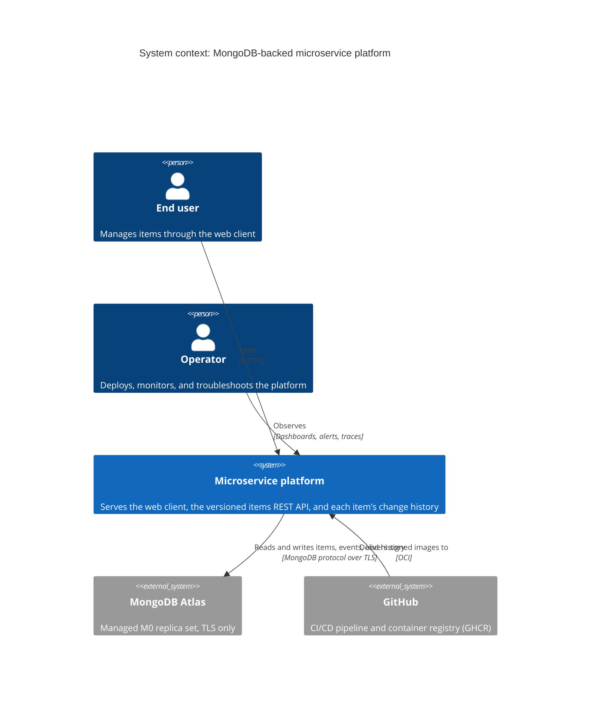
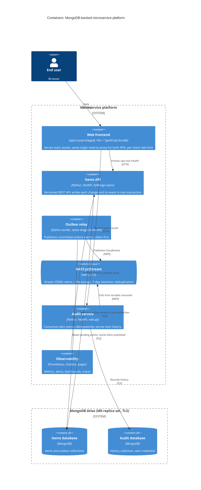
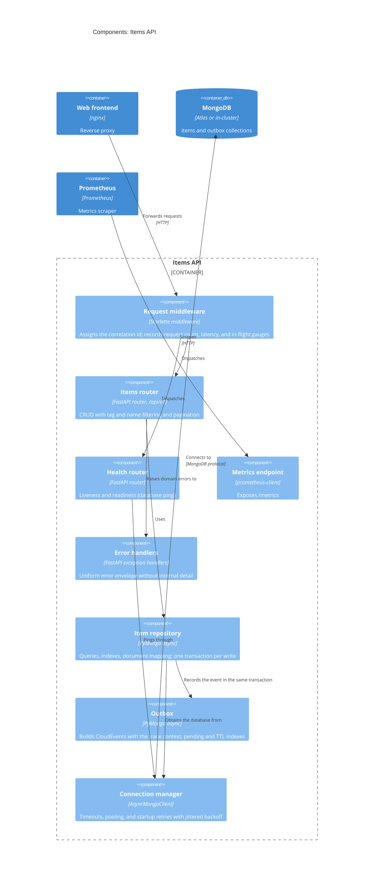
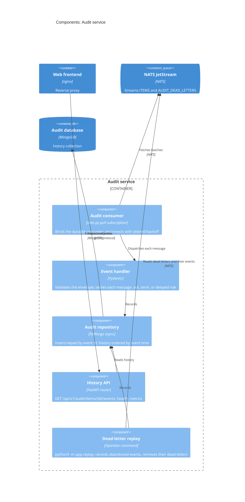
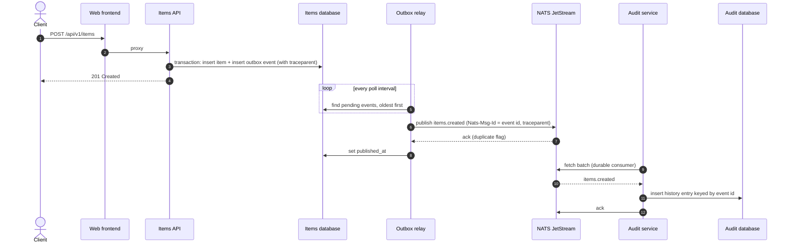

# Architecture (C4 model)

The system is described at the first three levels of the
[C4 model](https://c4model.com/): system context, containers, and the components
of the two services, followed by a dynamic view of one change travelling from
the API to the audit history. The diagrams are Mermaid source, versioned with
the code they describe and rendered natively by GitHub.

Delivery (the CI/CD pipeline, image publication, and the Kubernetes runtime
topology) is covered by the diagram in the [README](../README.md#architecture),
the reasoning behind each choice by the
[architecture decision records](adr/README.md), and the interfaces by the
[REST contract](api/openapi.json) and the [event contract](api/asyncapi.yaml).

## Level 1 — System context

Who uses the platform and which external systems it depends on.

## Level 2 — Containers

The deployable units inside the platform boundary. Item changes reach the audit
service only as events: the items API commits each change together with an
outbox event, the relay publishes it to JetStream, and the audit service
consumes it into its own database. The observability plane runs behind a
Compose profile locally and as a separate Kustomize overlay on Kubernetes; in
the `dev` overlay an in-cluster MongoDB replaces Atlas and Jaeger is enabled.

## Level 3 — Components of the items API

How a request flows through the service. Middleware wraps every route; the
repositories are the only components that issue database operations, and every
write goes through a transaction that also records its event.

## Level 3 — Components of the audit service

The consumer and the HTTP API share one process and one repository. The
consumer runs as a background task whose failures never affect the API's
readiness.

## Dynamic view — one change, end to end

A create request as it travels to the history. Steps 1 to 4 are synchronous and
answer the client; the rest happens afterwards, within about a second when the
pipeline is healthy. The trace context written in step 3 is what lets one trace
cover every step.

