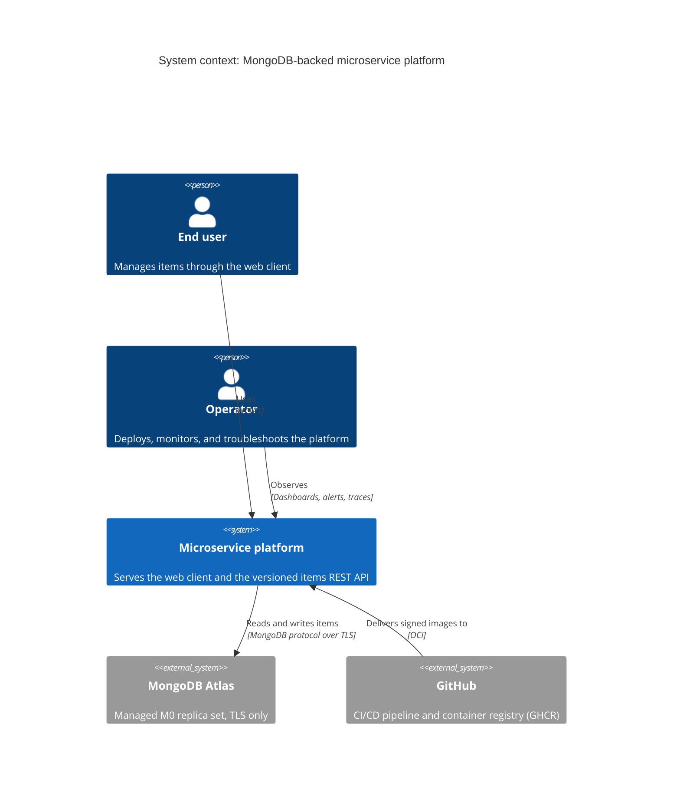
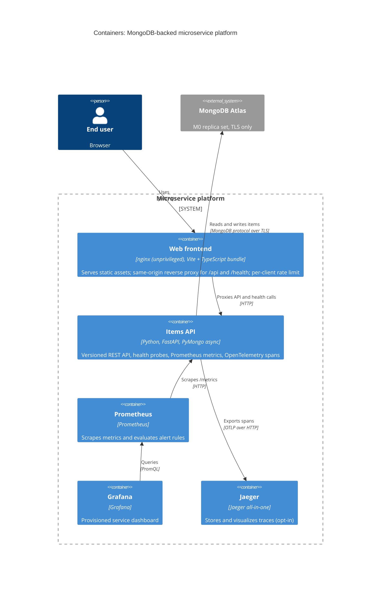
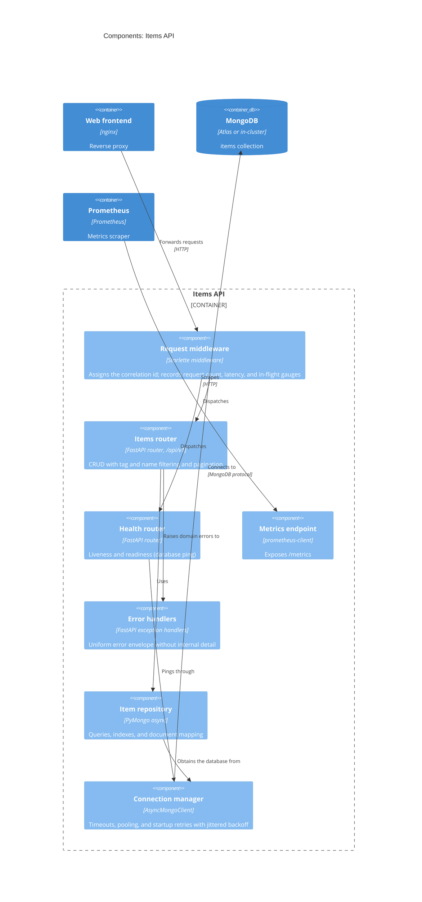

# Architecture (C4 model)

The system is described at the first three levels of the
[C4 model](https://c4model.com/): system context, containers, and the components
of the items API. The diagrams are Mermaid source, versioned with the code they
describe and rendered natively by GitHub.

Delivery (the CI/CD pipeline, image publication, and the Kubernetes runtime
topology) is covered by the diagram in the [README](../README.md#architecture),
and the reasoning behind each choice by the
[architecture decision records](adr/README.md).

## Level 1 — System context

Who uses the platform and which external systems it depends on.

## Level 2 — Containers

The deployable units inside the platform boundary. The observability plane runs
behind a Compose profile locally and as a separate Kustomize overlay on
Kubernetes; in the `dev` overlay an in-cluster MongoDB replaces Atlas.

## Level 3 — Components of the items API

How a request flows through the service. Middleware wraps every route; the
repository is the only component that issues database operations.

